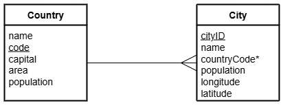

# H DDD Double Query Part 2

File: [Clydeview.db](../H-DDD-Clydeview/assets/Clydeview.db "Download file")

## Entity Relationship Diagram (ERD)

The tables called `Country` and `City` are shown below.

## Tasks

Create SQL queries to display the required details. 
Aliases should be used to display meaningful headings.

1.  Display the name, capital city and total population of the country with the largest total population.

    | country | capital | population |
    | ------- | ------- | ---------- |
    | China   | Beijing | 1210004956 |

2.  Display the name, country and population of any city that has a population which is at least 5,000,000 more than the average population of all the cities.

    | City     | Country        | population |
    | ----     | -------        | ---------- |
    | Moscow   | Russia         | 8717000 |
    | Istanbul | Turkey         | 7615500 |
    | London   | United Kingdom | 6967500 |
    | Beijing  | China          | 7000000 |
    | Shanghai | China          | 7830000 |

3.  Display the name of any city that is further north than Reykjavik (the latitude of these cities is greater than the latitude of Reykjavik).
The query should show the name of each relevant city, its latitude and country name.
The city that is furthest north should be listed first.

    | City         | Country  | Latitude |
    | ----         | -------  | -------- |
    | Longyearbyen | Svalbard | 78.13 |
    | Vadsoe       | Norway   | 70.5 |
    | Hammerfest   | Norway   | 70.4 |
    | Tromsoe      | Norway   | 69.4 |
    | Narvik       | Norway   | 68.3 |

4.  Display the name and population of any city in the United Kingdom that has a population which is more than the average population of all the cities in Bolivia.
Arrange these details from smallest to largest population.

    | City      | population |
    | ----      | ---------- |
    | Liverpool | 474000 |
    | Bradford  | 481700 |
    | Sheffield | 530100 |
    | Glasgow   | 674800 |
    | Leeds     | 724400 |

5.  Display the total number of countries with an area less than 1% of that of the country with the largest area.

    | Small Countries |
    | --------------- |
    | 148 |
