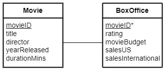

# H DDD Double Query Part 6

File: [Clydeview.db](../H-DDD-Clydeview/assets/Clydeview.db "Download file")

## Entity Relationship Diagram (ERD)

The tables called `Movie` and `BoxOffice` are shown below.

## Introduction

Create SQL queries to display the required details.
Aliases should be used to display meaningful headings.
Use a temporary view containing a single value in the first query, then use this value in the second query.
Example output is shown for each answer.
Only the first five records are shown where more than five records are returned.

## Tasks

1.  List the title, director and rating of the movie with the highest rating.

    | title  | director       | rating |
    | ------ | -------------- | ------ |
    | WALL-E | Andrew Stanton | 8.5    |

2.  List the title and duration of all movies not directed by John Lasseter that are longer than the average duration of his movies.
The longest movie should be listed first.

    | title               | durationsMins |
    | ------------------- | ------------- |
    | The Incredibles     | 116           |
    | Ratatouille         | 115           |
    | Monsters University | 110           |
    | Finding Nemo        | 107           |
    | WALL-E              | 104           |

3.  List the title and budget of any movie whose budget is less than that of the lowest-budget movie directed by Brad Bird.
Display the largest budget first; movies with the same budget should be listed in alphabetical order of title.

    | title         | movieBudget |
    | ------------- | ----------- |
    | Brave         | 300500000   |
    | WALL-E        | 275000000   |
    | Monsters Inc. | 250000000   |
    | Cars          | 245000000   |
    | Toy Story 2   | 240000000   |

4.  List the title, year of release and rating of all other movies that have a rating equal to or greater than the rating of the movie `Up`.
Display the highest-rated movie first; movies with the same rating should be listed in alphabetical order of title.

    | title       | yearReleased | rating |
    | ----------- | ------------ | ------ |
    | WALL-E      | 2008         | 8.5    |
    | Toy Story 3 | 2010         | 8.4    |
    | Toy Story   | 1995         | 8.3    |

5.  List the title and combined US and international sales of all movies whose combined sales are above the average combined sales for all movies.
Display the movie with the largest combined sales first.

    | title               | TotalSales |
    | ------------------- | ---------- |
    | Toy Story 3         | 1063171911 |
    | Finding Nemo        | 936743261  |
    | Monsters University | 743559607  |
    | Up                  | 731342744  |
    | The Incredibles     | 631442092  |

6.  List the title and profit of any movie released from 2005 onwards that made a greater profit than the most profitable movie released before 2005.
Display the most profitable movie first.

    **NB**: profit = US sales + international sales – movie budget

    | title       | Profit    |
    | ----------- | --------- |
    | Toy Story 3 | 563171911 |

7.  Calculate the number of movies directed by Brad Bird.
List the title and year of release of all movies whose duration in minutes is at least 60 times this number.
Display the earliest released movie first.

    **NB**: There are 60 minutes in an hour.

    | title  | yearReleased |
    | ------ | ------------ |
    | Cars 2 | 2011         |

8.  Display the number of movies that do not have a title beginning with `Toy Story` but have a rating greater than the average rating of the movies whose titles begin with `Toy Story`.

    | Number of Movies |
    | ---------------- |
    | 2                |
