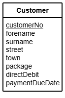
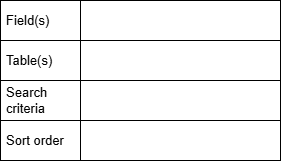

# N5 DDD Entity and ERD Design

## Introduction

The Customer entity stores details of the customers of a mobile phone company.
The entity has the 8 attributes listed below.

Before queries are written, they are designed by stating the fields and tables that will be used, plus the search citeria and the display order.
This layout is useful designing a `SELECT` query:

## Tasks

Design queries to perform each of the following tasks.

1.  Search the database to display the full name (forename and surname) of the customer with the surname "Rice".

2.  Search the database to display the full name and town of all customers who live in Inverkip.

3.  Search the database to display the surname, package and town of all the customers who are on the large package.

4.  Search the database to display the surname, town and street of all the customers who live in Port Glasgow.

5.  Display the forename, surname and town of all of the customers and sort these details into alphabetical order of surname.

6.  Display the forename, surname and paymentDueDate of all the customers and sort these details into descending order of paymentDueDate.

7.  Display the forename, surname and customerNo of all the customers with a customerNo greater than 110.  Sort the details into alphabetical order of forename.

8.  Search the database to display the full name and town of all the customers who live in Kilmacolm.  Sort the details into alphabetical order of surname.
