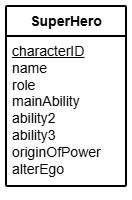
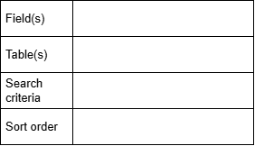

# N5 DDD Query Design Part 2

## Introduction

The SuperHero entity stores details of the customers of a mobile phone company.
The entity has the 8 attributes listed below.

Before queries are written, they are designed by stating the fields and tables that will be used, plus the search citeria and the display order.
This layout is useful for designing a `SELECT` query:

## Tasks

Design `SELECT` queries to perform each of the following tasks.

1.  Search the database to find a character who played the role of 'Super Hero' with 'Acrobatics' as his/her main ability.
Display the character's name, role and main ability.

2.  Search the database to find a character who played the role of 'Henchman' whose main ability is 'Strength'.
Display the character's name, role and main ability.

3.  Search the database to find a character who played the role of 'Super Villain' whose main ability is 'magic' and whose origin of power is 'training'.
Display the character's name, role, main ability and origin of power.

4.  Search the database to find a character who played the role of 'Super Hero' with the main ability ‘Magic’ whose origin of power is 'Training'.
Display the character's name, role, main ability and origin of power.

5.  5.	Search the database to find a character who played the role of 'Super Villain' whose origin of power is 'Chemicals' and who has 'Gadgets' as ability 2.
Display the character's name, role, ability2 and origin of power.

6.  Search the database to find a character who played the role of 'Team member' and has the main ability ‘Water breathing’.
Display the character's name, role and main ability.

7.  Search the database to find a character who played the role of 'Super Hero' who has the main ability 'Flight', ability 2 'Super-strength' and origin of power 'Technology'.
Display the character's name, role, main ability, ability 2 and origin of power.

8.  Search the database to find a character who played the role of 'Super Villain' with the main ability 'Intelligence' and ability 2 'Martial arts'.
Display the character's name, role, main ability and ability 2.
