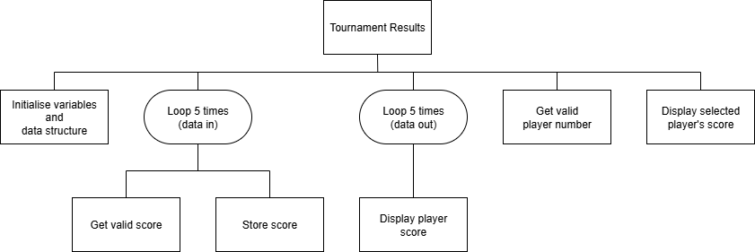

# N5 SDD - Arcade

## Introduction

The school gaming club is holding an arcade tournament.
Five players are competing to see who can achieve the highest score in a computer game.
The maximum possible score is 200.

A program is needed to record the five players' scores and display them when required.


### Top level design (structure diagram)




## Tasks

1. Implement a program that matches the design.
2. Ensure the code is efficient.
3. Test the code


### Assumptions

* All scores are whole numbers.
* All player numbers are whole numbers.


## User Experience

An example of the expected user interface are shown below, with possible input and output values.

```Python
Arcade Tournament
-----------------

Enter the scores:

  Player 1: 120
  Player 2: 85
  Player 3: 200
  Player 4: 150
  Player 5: 95

-----------------

Tournament Results
------------------

Player 1 scored 120 points
Player 2 scored 85 points
Player 3 scored 200 points
Player 4 scored 150 points
Player 5 scored 95 points

------------------

Individual Result
-----------------

Enter a player's number: 3

Player 3 scored 200 points

=================
```


## Testing

Conduct the following tests.

| Test<br>No | Scores<br>(Players 1–5) | Player | Test Type   | Expected                                             | Actual | Comment |
| :--:       | ------                  | :----: | ---------   | --------                                             | ------ | ------- |
| 1          | 120, 85, 200, 150, 95   | 3      | Normal      | All scores displayed.<br>Player 3 scored 200 points. |        | |
| 2          | 0, 50, 100, 150, 200    | 3      | Extreme     | All scores displayed.<br>Player 3 scored 100 points. |        | |
| 3a         | -1                      |        | Exceptional | Error / Re-enter score.                              |        | |
| 3b         | 201                     |        | Exceptional | Error / Re-enter score.                              |        | |
| 3c         | 10, 20, 30, 40, 50      | 3      | Normal      | All scores displayed.<br>Player 3 scored 30 points.  |        | |
| 4          | 10, 20, 30, 40, 50      | 1      | Extreme     | Player 1 scored 10 points.                           |        | |
| 5a         | 10, 20, 30, 40, 50      | 0      | Exceptional | Error / Re-enter player number.                      |        | |
| 5b         |                         | 6      | Exceptional | Error / Re-enter player number.                      |        | |
| 5b         |                         | 5      | Extreme     | Player 5 scored 50 points.                           |        | |
