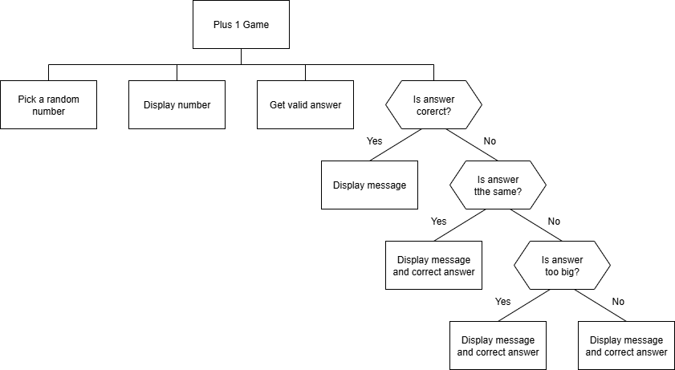
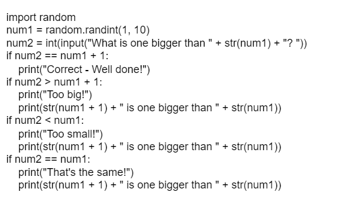

# N5 SDD - Chance Part 4

The local nursery wants to help children practise the concept of plus 1, using the numbers 1 to 10.

## Analysis

The program will pick a random value, 1 to 9, and show it to the child.
The child is then asked what number is one more than the number shown.

The child could provide an answer that is classified as:

* correct
* the same
* too big
* too small

An appropriate message should be displayed, and the correct answer given if incorrect.

### Input

* enter a valid answer

### Process

* pick a random number
* determine how the answer compares with the random number

### Output

* a message is displayed if the answer is correct
* a message, including the correct answer, is displayed if the answer is the same
* a message, including the correct answer, is displayed if the answer is too big
* a message, including the correct answer, is displayed if the answer is too small

### Assumptions

* the answer that a child can give is from 1 to 10 inclusive
* all values are integers

## Design

## Implementation

The design was implemented, as shown below.

## Testing

    | Test No | Random Number | User Input | Test Type   | Expected               | Actual | Comment |
    | :-----: | :-----------: | :--------: | ---------   | --------               | ------ | ------- |
    | 1       | ?             | 5          | Normal      | An appropriate message |        | |
    | 2       | ?             | 1          | Extreme     | An appropriate message |        | |
    | 3a      | ?             | 0          | Exceptional | Error / Re-enter       |        | |
    | 3b      | ?             | 11         | Exceptional | Error / Re-enter       |        | |
    | 3c      | ?             | 10         | Extreme     | An appropriate message |        | |
    | 4       | 5             | 6          | Normal      | "Correct!"             |        | |
    | 5       | 5             | 5          | Normal      | "That number is the same. The answer is 6."  | | |
    | 6       | 5             | 7          | Normal      | "That number is too big. The answer is 6."   | | |
    | 7       | 5             | 4          | Normal      | "That number is to0 small. The answer is 6." | | |
