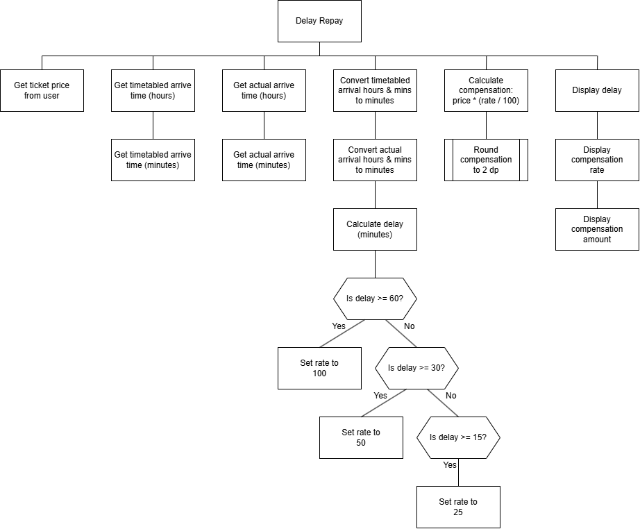

# N5 SDD - Delay Repay


## Introduction

The Barra & Uist Train Service (BUTS) runs an efficient train service.
BUTS is the envy of the rail industry as nearly 100% of trains running on time, as they should.
If a train is late, then customers are entilted to a refund, depending how bad the delay was.
The compensation scheme is known as **Delay Repay**.

The amount of compensation depends on the length of the delay, see the table below.

| Delay (mins) | Compensation |
| :----------: | :----------: |
| 15-29        | 25% |
| 30-59        | 50% | 
| 60+          | 100% |


## Task

Create a program that will calculate the compensation to be paid when a train is late.


### Top Level Design (Structure diagram)




## User Interface

Examples of the expected user interface are shown below, with some possible input and output values.


### Example 1

```
BUTS Delay Repay
----------------

Ticket price: £126.64

Timetabled arrival time:
  Hour: 9
  Mins: 26

Actual arrival time:
  Hour: 9
  Mins: 42

Delay: 16 mins
  Rate: 25%
  Compensation: £31.41
================
```
