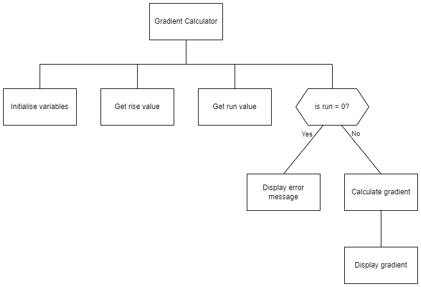
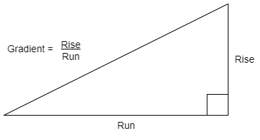

# N5 SDD - Gradient Calculator Part 2


## Task

Calculate the gradient of a slope when the user enters values for the **rise** and the **run**.
Round the result to 2 decimal places.


### Top level design (Structure diagram)




### Calculate gradient




### Example User Interface

```
Gradient Calculator
-------------------

                   .
               .   |
           .       |
       .           | Rise
   .               |
-------------------|
       Run


What is the rise? 2.5
What is the run? 15

           Rise   2.5
Gradient = ---- = ----
           Run    15.0

Gradient = 0.17
===============
```


## Assumptions

1. The `run` will never be zero.
