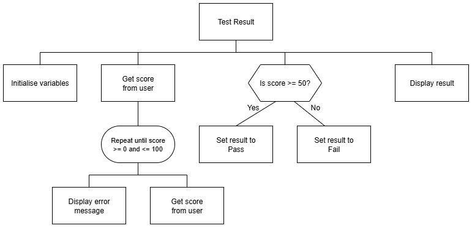

# N5 SDD - Result Part 3


## Introduction

A teacher wants an automatic grading system that will classify a test score using the table below.

| Score    | Result |
| :----:   | :----: |
| 50-100   | Pass |
| 0-49     | Fail |

Only scores from ***0*** to ***100*** are acceptable.


### Top level design (structure diagram)




## User Interface

Examples of the expected user interface are shown below, with some possible input and output values.


### Example 1

```
Test Result
-----------

Score: 75

Result: Pass

============
```


### Example 2

```
Test Result
-----------

Score: 101

Only scores from 0 to 100 can be used.
Score: 1

Result: Fail

============
```


## Testing

USe the test table below to test the program.
If errors are found, correct the program and run all the tests again.

    | Test No | Test Data | Test Type   | Expected         | Actual | Comment |
    | :-----: | :-------: | ---------   | --------         | ------ | ------- |
    | 1       | 25        | Normal      | "Result: Fail"   |        | |
    | 2       | 75        | Normal      | "Result: Pass"   |        | |
    | 3       | 49        | Extreme     | "Result: Fail"   |        | |
    | 4       | 50        | Extreme     | "Result: Pass"   |        | |
    | 5       | 0         | Extreme     | "Result: Fail"   |        | |
    | 6a      | -1        | Exceptional | Error / Re-enter |        | |
    | 6b      | 101       | Exceptional | Error / Re-enter |        | |
    | 6c      | 100       | Extreme     | "Result: Pass"   |        | |
